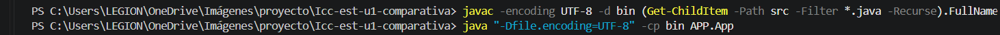
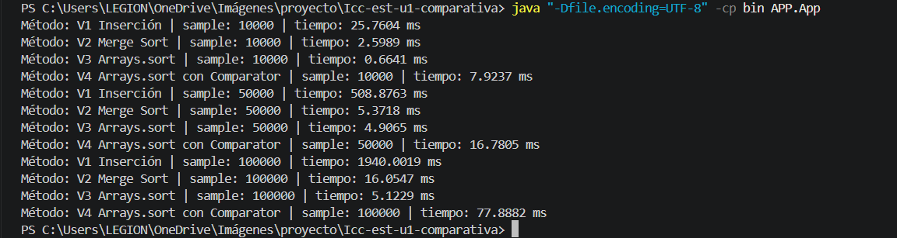

## Comparación de algoritmos de ordenamiento en Java

# Autor
Nombre: Wilson David Bravo Salazar
Lenguaje de programación: Java 17
Entorno de desarrollo: Visual Studio Code
Sistema operativo: Windows 11

# Objetivo

El objetivo de este proyecto es el de implementar y comparar los diferentes metodos de ordenamiento usando la medicion de los tiempos de ejecucion. Para esto se necesitaban arreglos de números generados de forma aleatoria y con tamaños de 10.000, 50.000 y de 100.000 elementos.

Mediante la compracion se puede obtener el tiempo de ejecucion de cada metodo. 

# Metodos de Ordenamiento Utilizados

Se usaron cuatro varianes:
1. V1 - Insercion: Ordena los elementos usando las comparaciones y el desplazamiento de elementos hasta colocarlos de forma ordenada. 
2. V2 - Mega Sort: Este divide el arreglo en partes más pequeñas, las ordena y luego las une. 
3. V3 - Arrays.sort: usa el metodo de ordenamiento que nos da la biblioteca estandar de java para arreglos int[]
4. V4 - Arrays.sort con Comparator: utiliza un arreglo Integer[] y un comparador para poder ordear los elementos de foma numerica y de forma ascendente. 

# Organizacion del Proyecto
Se organizo dividiendolo en paquetes esto para poder separar las responsabilidades de cada clase. 

En el paquete generador esta el Generador. java el cual genera los arreglos de los numeros aleatorios.

En el de algorimos estaria: MetodosOrd.java en este es donde se implementan los metodos de ordenamiento como el de insercion y el Merge SSort.

En el de benchmark esta el Benchmark.java aqui se mide el tiempo de ejecucion de cada operación. Tambien esta el Resultado.java este almacena el método, el tamaño de muestra y la duracion de las mismas. 

Ahora en el de experimento esta el Controlador.java aqui se coordinan los experimentos y se verifican los resultados obtenidos

Por ultimo estaria la APP que esta App.java aqui se ejecuta el programa y muestra los resultados que se obtuvieron al final. 

#Compilación y ejecución
para que se ejecute el programa se utilizo el siguiente comando: 
 Esto en la carpeta principal, ya que con el F5 no logra ejecutar y tampoco usando el debug ya que no se puede instalar las extenciones en este dispositivo. 

 Todo esto se pone en el PowerShell y permiten usar el programa correctamente. 

 #Funcionamiento del benchmarking

 Para poder medir el tiempo de ejecucion se utilizo la clase benchmark, aqui se recibe una operacion mediante la interfaz Runnable. 
 Estas operaciones se envian usando expresiones lambda. El tiempo inicial se obtiene con un System.nanoTime() y antes de ser ejecutado el ordenamiento y el tiempo final se registran al terminar. 
 
 La clase benchmark solo mide la operacion que se recibe. Todo lo demas le corresponde al Controlador. 

 # Procedimiento de los experimentos 

 Al usarse lso tres tamaños de muestra: 10.000, 50.000 y 100.000 elementos.

 Cada tamaño generaba un unico arreglo original con nuemros aleatorios entre 0 y el tamaño que le tocaba.

 Antes de ejecutarse cada variante se prepara una copia del arreglo original. Esto porque sino ya estarian arreglados antes de llegar a los metodos, entonces todos reciben los mismos valores iniciales. 

 Luego de cada medicion se comprueba que todos los elementos esten ordenados correctamente y que no se hayan perdido valores o se hayan modificado.

 Cada resultado correcto se lo agrega a una lista List<Resultado>, que imprime todo al finalizar las pruebas. 

 # Resultados y Evidencias Obtenidos

 

# Conclusiones

1. Al realizarse las pruebas se puede observar que el metodo de insercion llega a ser el que mas tiempo necesito para ordenar los elementos. Con 10.000 tardandose 25.7604 ms, y con 50000 | tiempo: 508.8763 ms. Entonces esto me dio a entender que este algoritmo funciona bien con pocos datos pero cuando ya son varios su rendimiento disminuye. 

2. Ahora el Merge Sort tiene mejores tiempos que el del inserción en las tes pruebas realizadas. Digamos con 10000 | tiempo: 2.5989 ms. Asi demostrando que este algoritmo es mas eficiente cuando esta con muestras de datos mas grandes. 

3. Al comparar los metodos con la biblioteca de Java, se puede observar que arrays.sort con int[] fue mas rapido que el de Arrays.sort con comparator con las tres muestra. Asi que me enseño que la forma en como se muestran lso datos tambien pueden influir en el tiempo de ejecicion. 