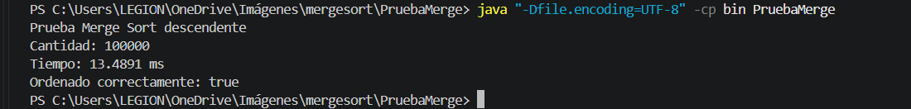
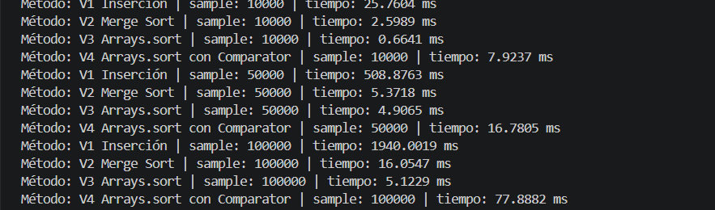

## Investigacion del algoritmo Merge Sort

# Identificacion del algoritmo

Para este proyecto se utilizo el Merge Sort como segundo metodo de ordenamiento (V2). Su implementacion se encuentra en la clase MetodosOrd.java, dentro de el metodo mergeSort(int [] a). Este algoritmo utiliza la tecnica de dividir y conquistar para poder ordenar los numeros de forma ascendente.

# Funcionamiento

Merge Sort divide el arreglo en dos mitades y continua separandolos mediante recursividad hasta obtener arreglos de un solo elememto. Luego compara los valores de cada mitad y los combina de menor a mayor. 

El metodo recibe un arreglo int [] y lo modifica directamente. La recursividad termina cuando el arreglo tiene menos de dos elementos. 

# Implementacion 
En el codigo se usa a.lenght / 2 esto para calcular la mitad y crear dos arreglos auxiliares llamados izq y der. Luego llama nuevamente a mergeSort() para ordenar ambas partes. 

Para que se mesclen se usa tres indices ( i, j y k). La condicion izq[i] <= der[j] permite colocar primero el elemento izquierdo cuando existen valores iguales, manteniendo la estabilidad del algoritmo.

# Traza manual

Arreglo inicial: [7, 2, 7, 0, 4, 2]

Division:

[7, 2, 7, 0, 4, 2]
     /        \
[7, 2, 7]   [0, 4, 2]
  /   \       /   \
[7] [2, 7]  [0] [4, 2]
     / \          / \
   [2] [7]      [4] [2]

Mezcla:

[2] + [7] → [2, 7]

[7] + [2, 7] → [2, 7, 7]

[4] + [2] → [2, 4]

[0] + [2, 4] → [0, 2, 4]

[2, 7, 7] + [0, 2, 4] → [0, 2, 2, 4, 7, 7]

Resultado final: [0, 2, 2, 4, 7, 7]

# Complejidad y memoria

Merge Sort tiene una complejidad de O(n log n) en el mejor, promedio y en el peor caso, ya que siempre divide y combina elementos.

Usa O(n) de memoria auxiliar para los arreglos temporales y O(log n) de pila recursiva. Esto establece porque conserva el orden relativo de los elementos iguales. 

# Caso desfavorable

Para analizar el comportamiento del Merge Sort se realizo una prueba con 100.000 elementos ordenados descendentemente. El algoritmo tardo 13.4891 ms y logro ordenar correctamente todos los elementos. 

Este resultado demuestra que merge Sort puede trabajar con arreglos en orden inverso sin perder su complejidad O(n log n). Sin embargo, el orden descendente no necesariamente representaria su peor caso. 

# Benchmarking y referencias 

En las pruebas realizadas, Merge Sort presento mejores tiempos que insercion. Con 100.000 tardo  16.0547 ms, mientras que el de insercion necesito 1940.0019 ms.

Es asi que se demuestra que, Merge Sort tuvo mejor rendimiento con grandes cantidades de elementos. Aun asi, los tiempos pueden ir variando entre ejecuciones. 

REFERENCIAS

Sedgewick, R., & Wayne, K. (s. f.). Mergesort. Princeton University. https://algs4.cs.princeton.edu/22mergesort/

Feofiloff, P. (s. f.). Mergesort. Universidade de São Paulo. https://www.ime.usp.br/~pf/algorithms/chapters/mergesort.html
